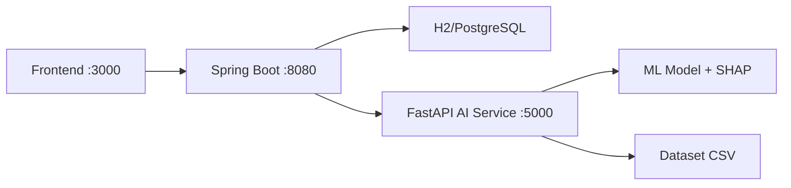

# 🎓 XAI StudyMate — Explainable AI Student Placement Predictor

A full-stack, AI-powered student placement prediction system with **SHAP explainability**, personalized study plans, and an **admin dashboard** for monitoring at-risk students. Built with a modern microservice architecture.


---

## ✨ Features

| Feature | Description |
|---------|-------------|
| 🔮 **Placement Prediction** | Dual-model pipeline (RandomForest classifier + regressor) predicts placement status and expected package |
| 🔍 **SHAP Explainability** | Per-feature SHAP analysis shows exactly what helps/hurts your placement chances |
| 📋 **Personalized Study Plan** | AI-generated 8-week improvement roadmap with prioritized action items |
| 💬 **AI Study Tutor** | Rule-based chatbot for placement preparation advice |
| 📊 **Model Dashboard** | View classification/regression metrics and global feature importances |
| 👑 **Admin Dashboard** | Monitor at-risk students, view analytics, contact students via email/phone |
| 🔐 **JWT Authentication** | Secure login/register with role-based access (Student/Admin) |
| 🌙 **Dark Theme UI** | Modern glassmorphism design with smooth animations and radial gauges |

## 🏗️ Architecture

```
XAI-StudyMate/
├── Indian_Student_Placement_Dataset_2025.csv   # 12,000 student records
├── ai-service/                                  # Python AI Microservice
│   ├── requirements.txt
│   ├── models/                                  # Trained model artifacts
│   └── app/
│       ├── model.py          # PlacementModel — train/load/predict
│       ├── explainer.py      # SHAP TreeExplainer
│       ├── recommender.py    # Study plan generator
│       ├── schemas.py        # Pydantic request/response models
│       └── main.py           # FastAPI endpoints
├── backend/                                     # Java Spring Boot Backend
│   ├── pom.xml
│   └── src/main/java/com/xaistudymate/backend/
│       ├── config/           # Security, CORS, RestTemplate, DataSeeder
│       ├── controller/       # Auth, Prediction, Chat, Admin, Dashboard
│       ├── dto/              # Request/Response DTOs
│       ├── entity/           # JPA entities (User, StudentProfile, etc.)
│       ├── exception/        # Global exception handling
│       ├── repository/       # Spring Data JPA repositories
│       ├── security/         # JWT filter, provider, UserDetailsService
│       └── service/          # Business logic + AI service client
└── frontend/
    └── index.html            # Single-page app (vanilla HTML/CSS/JS)
```



## 🚀 Quick Start

### Prerequisites
- **Java 21+** and **Maven 3.9+**
- **Python 3.10+** with pip

### 1. Install AI Service Dependencies
```bash
cd ai-service
python -m venv venv
venv\Scripts\activate   # Windows
pip install -r requirements.txt
```

### 2. Start the AI Service (port 5000)
```bash
cd ai-service
venv\Scripts\python -m uvicorn app.main:app --host 0.0.0.0 --port 5000
```
> First run trains the model automatically (~2 seconds). Subsequent runs load instantly.

### 3. Start the Spring Boot Backend (port 8080)
```bash
cd backend
mvn spring-boot:run "-Dspring-boot.run.profiles=dev"
```
> Uses H2 in-memory database — no PostgreSQL installation needed for development.
> An admin user is auto-seeded on startup.

### 4. Start the Frontend (port 3000)
```bash
cd frontend
python -m http.server 3000
```

### 5. Open in Browser
Navigate to **http://localhost:3000**

### Default Credentials

| Role | Email | Password |
|------|-------|----------|
| 👑 Admin | `admin@xaistudymate.com` | `admin123` |
| 🎓 Student | Register a new account | Your choice |

## 📡 API Endpoints

### Auth (Public)
| Method | Endpoint | Description |
|--------|----------|-------------|
| `POST` | `/api/auth/register` | Register new user |
| `POST` | `/api/auth/login` | Login, get JWT |
| `GET` | `/api/auth/me` | Get current user |

### Student (JWT Required)
| Method | Endpoint | Description |
|--------|----------|-------------|
| `POST` | `/api/predict` | Placement prediction |
| `POST` | `/api/explain` | SHAP-based explanations |
| `POST` | `/api/study-plan` | Personalized study plan |
| `POST` | `/api/chat` | AI study tutor |
| `GET` | `/api/model-info` | Model metrics & importances |

### Admin (JWT + Admin Role)
| Method | Endpoint | Description |
|--------|----------|-------------|
| `GET` | `/api/admin/dashboard` | Overview stats + student list |
| `GET` | `/api/admin/at-risk` | Students with <50% probability |
| `GET` | `/api/admin/students/{id}/study-plan` | Student study plan detail |

## 🤖 ML Pipeline

- **Classification**: RandomForestClassifier (250 trees) → Placed / Not Placed
- **Regression**: RandomForestRegressor (200 trees) → Predicted Package (LPA)
- **Explainability**: SHAP TreeExplainer with domain-knowledge overrides
- **Dataset**: Indian Student Placement Dataset 2025 (12,000 records, 16 features)

### Top Predictive Features
1. **Coding Skills** — 40.9% importance
2. **Aptitude Score** — 33.2% importance
3. **CGPA** — 21.4% importance

## 🛠️ Tech Stack

| Layer | Technology |
|-------|-----------|
| **AI Service** | Python, FastAPI, Scikit-learn, SHAP, Pandas |
| **Backend** | Java 21, Spring Boot 3.3.5, Spring Security, JPA |
| **Database** | H2 (dev) / PostgreSQL (prod) |
| **Auth** | JWT (jjwt 0.12), BCrypt |
| **Frontend** | Vanilla HTML/CSS/JS, Inter font, Glassmorphism |

## 📄 License

MIT License — feel free to use and modify.
